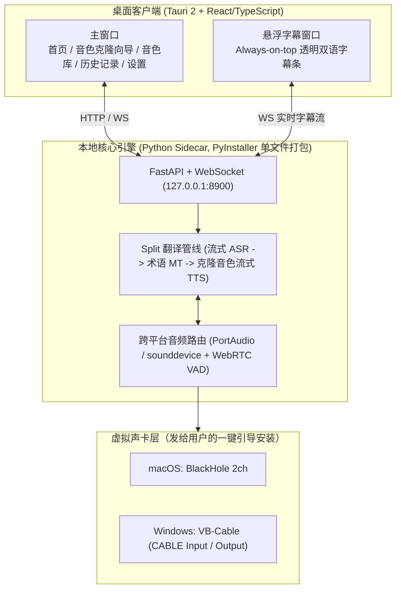

# 跨平台架构设计（macOS + Windows 可分发桌面端）

本项目从零开始按 **“独立产品 + 跨平台（macOS / Windows）+ 一键打包发给别人用”** 设计，与获客系统零耦合。

## 1. 总体技术选型

### 为什么选 Tauri 2 + Python Sidecar？
1. **双端打包发给别人用**：Tauri 支持生成 macOS `.dmg` 与 Windows `.exe`/`.msi`，Python 引擎用 PyInstaller 打成 Sidecar 二进制嵌入安装包，**终端用户无需安装 Python 或任何环境**。
2. **悬浮字幕体验**：Tauri 原生支持 `transparent` + `alwaysOnTop` + `decorations: false` 独立子窗口，可完美实现类似变色龙同传的“可拖拽半透明双语悬浮字幕条”。
3. **跨平台虚拟声卡**：
   - **macOS**：检测并引导安装开源 `BlackHole 2ch`；
   - **Windows**：检测并引导安装 `VB-Cable`（或后续升级为虚拟声卡驱动），代码层通过设备名自动匹配，无需两套业务代码。

## 2. 后续开发里程碑
- **Phase 1（当前）**：完成独立后端引擎（音色克隆 + Split 翻译管线 + 跨平台音频设备发现/路由接口）。
- **Phase 2**：接入实时麦克风采集 + VAD 端点检测 + 虚拟声卡实时播报（跑通真实会议双向同传）。
- **Phase 3**：搭建 Tauri 2 + React 桌面 UI（首页、4 步录样音色克隆、音色库、悬浮双语字幕条、设置与引导页）。
- **Phase 4**：配置 PyInstaller + Tauri 打包流水线，产出 macOS `.dmg` 与 Windows `.exe` 安装包分发给他人使用。
